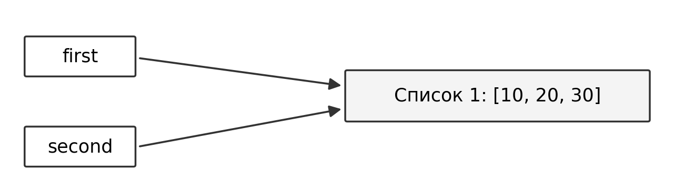
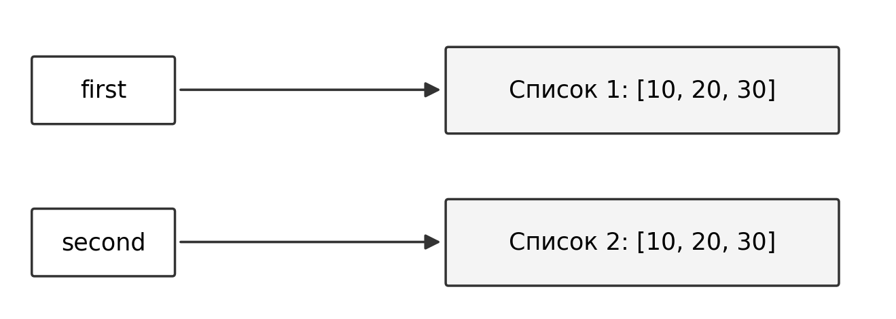
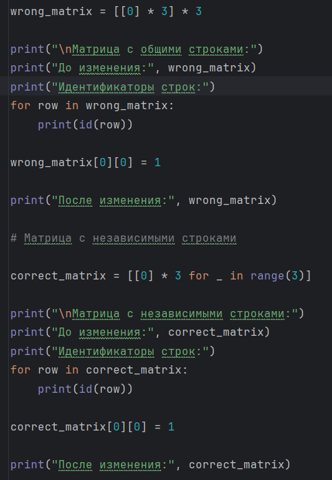
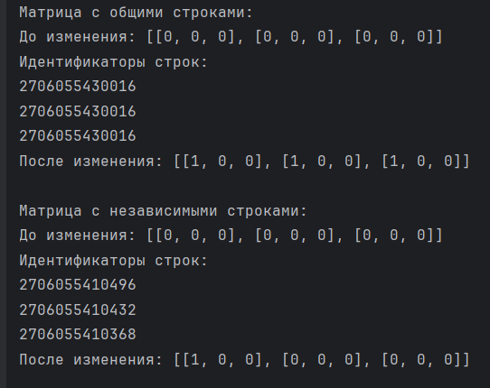
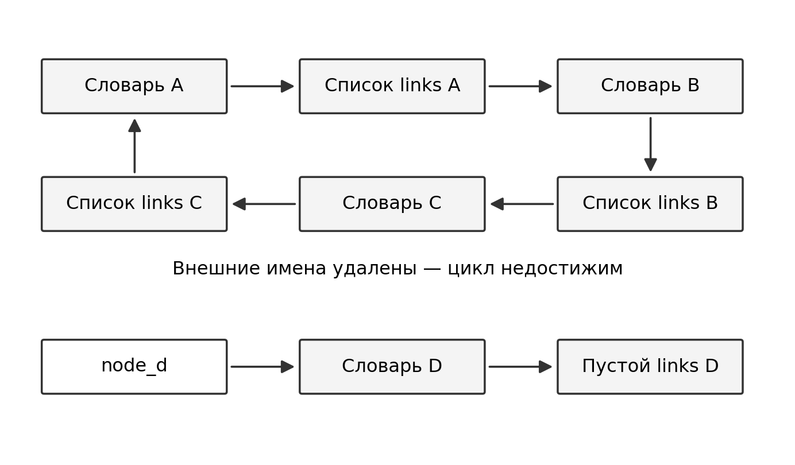
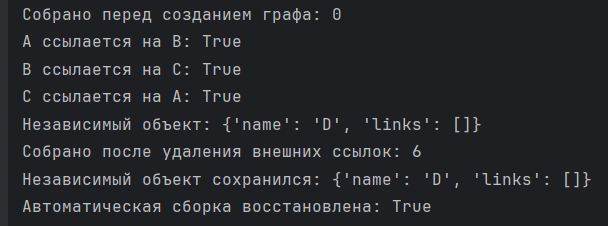
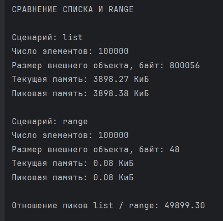

# Лабораторная работа № 2

## Управление объектами и памятью в Python

Выполнил: Тукмаков Савва Денисович, группа K3121.

Дисциплина: Основы программирования. Проверил: Летенков Илья Алексеевич.

### Цель и среда выполнения

Цель работы — разобраться, как имена связаны с объектами, чем отличаются способы копирования и как Python освобождает память. Также нужно сравнить, сколько памяти занимают разные объекты.

Работа выполнена в PyCharm на Windows, версия интерпретатора — CPython 3.12.6, 64 bit. Использованы модули `copy`, `sys`, `weakref`, `gc` и `tracemalloc`. Идентификаторы и статистика сборщика могут отличаться при повторном запуске. Важно, какие ссылки ведут к одному объекту, а какие — к разным.

## Задание 1 — Имена, ссылки и изменяемость

Код задания: [task_1.py](task_1.py).

### Эксперимент А — Неизменяемый объект

```python
a = 10
b = a
a += 1
```

До операции `a += 1` обе переменные имели значение `10` и ссылались на один объект: их идентификаторы совпадали. После операции значение `a` стало равно `11`, а значение `b` осталось равно `10`. Идентификатор объекта, связанного с `a`, изменился.

Объекты типа `int` неизменяемы. Поэтому операция не изменила число `10`, а связала имя `a` с результатом вычисления — числом `11`. Имя `b` осталось связано с прежним объектом.

### Эксперимент Б — Изменяемый объект

После присваивания `second = first` оба имени ссылались на один список. Добавление `30` через `second.append(30)` изменило общий список: через оба имени выводилось `[10, 20, 30]`. Идентификатор списка сохранился.

После `second = [10, 20, 30]` имя `second` стало ссылаться на новый список. Проверка `first == second` вернула `True`, а `first is second` — `False`: содержимое одинаковое, объекты разные.

После добавления `40` в новый список получены результаты:

```text
first: [10, 20, 30]
second: [10, 20, 30, 40]
```

Первый список не изменился. На схемах показаны ссылки до и после переназначения `second`, ещё до добавления `40`.



*Рисунок 1 — Оба имени ссылаются на один список*



*Рисунок 2 — Имена ссылаются на разные списки с равными значениями*

### Практическая задача — Конфигурации проекта

Первая конфигурация содержит название, участников и вложенный список параметров запуска:

```python
config_1 = {
    "name": "Учебный проект",
    "members": ["Савва", "Анна"],
    "settings": [["mode", "test"], ["attempts", 3]]
}
config_2 = config_1
```

Во второй конфигурации добавлен участник Иван и изменён режим на `release`. Изменения появились и в первой конфигурации. Проверка `config_1 is config_2` вернула `True`: оба имени ссылались на один словарь с общими вложенными списками.

Затем вторая конфигурация создана через `copy.deepcopy(config_1)`. В ней изменено название, добавлен Олег и увеличено число попыток до 5. Эти изменения уже не затронули первую конфигурацию:

| Параметр | Первая конфигурация | Независимая вторая конфигурация |
|---|---|---|
| Название | Учебный проект | Второй проект |
| Участники | Савва, Анна, Иван | Савва, Анна, Иван, Олег |
| Режим | release | release |
| Число попыток | 3 | 5 |

С помощью `assert` проверено, что конфигурации и их вложенные списки — разные объекты. Также проверено, что значения первой конфигурации не изменились. Все проверки прошли. Программа вывела: «Проверки пройдены: конфигурации и их вложенные списки независимы».

### Ответы на вопросы

1. **Меняет ли присваивание `second = first` сам объект?** Нет. После присваивания оба имени ссылаются на один объект.
2. **Почему операция над неизменяемым объектом приводит к связыванию имени с другим объектом?** Исходный объект изменить нельзя. Поэтому, если результат отличается, имя начинает ссылаться на другой объект. В нашем примере `a` начинает ссылаться на `11` вместо `10`.
3. **Как определить, что два имени обозначают один объект?** Использовать `is`. У одного и того же объекта одинаковый `id()`. Оператор `==` проверяет равенство значений, а не идентичность.

## Задание 2 — Поверхностное и глубокое копирование

Код задания: [task_2.py](task_2.py).

### Сравнение способов копирования

```python
import copy

original = [["Python", 5], ["Algorithms", 4]]
alias = original
shallow = original.copy()
deep = copy.deepcopy(original)
```

Идентификаторы внешних списков у `original` и `alias` совпали: это один список. У `shallow` и `deep` внешние списки отдельные. Первый вложенный список оказался общим для `original`, `alias` и `shallow`. У `deep` он другой.

После `original.append(["Databases", 5])` новый предмет появился только в `original` и `alias`. Затем выполнено `original[0][1] = 3`:

```text
original: [['Python', 3], ['Algorithms', 4], ['Databases', 5]]
alias: [['Python', 3], ['Algorithms', 4], ['Databases', 5]]
shallow: [['Python', 3], ['Algorithms', 4]]
deep: [['Python', 5], ['Algorithms', 4]]
```

До изменения оценка `5` во всех четырёх структурах была одним объектом. Числа неизменяемы, поэтому `deepcopy()` не обязан создавать для них новые объекты.

После изменения оценки в общем вложенном списке ссылка на `5` заменилась ссылкой на `3`. Поэтому `original`, `alias` и `shallow` показывают `3`. У `deep` вложенный список отдельный, и в нём осталась `5`. Само число не менялось. Причина здесь в копировании списков, а не в кеше малых чисел.

| Операция | Новый внешний объект | Новые вложенные объекты | Изменения независимы |
|---|---|---|---|
| Присваивание | Нет | Нет | Нет |
| Поверхностная копия | Да | Нет | Только изменения внешнего контейнера |
| Глубокая копия | Да | Да, вложенные списки | Да, для данной структуры |

### Создание матрицы

При повторении `[[0] * 3] * 3` внешний список получает три ссылки на одну строку. После изменения `wrong_matrix[0][0]` единица видна во всех трёх строках.

В выражении `[[0] * 3 for _ in range(3)]` внутренний список создаётся заново на каждой итерации. Поэтому изменение первой строки не затрагивает остальные.



*Рисунок 3 — Создание матриц с общей и независимыми строками*



*Рисунок 4 — Общая строка изменяется во всех позициях, независимая — только в одной*

В ошибочной матрице идентификаторы всех строк совпадают, в корректной — различаются. Операция `[0] * 3` повторяет ссылки на неизменяемый объект `0`. Присваивание в элемент списка заменяет ссылку, а не меняет число.

### Ответы на вопросы

1. **Чем поверхностная копия отличается от глубокой?** Поверхностная копия создаёт новый внешний контейнер, но вложенные объекты остаются общими. Глубокая копия копирует и вложенные объекты. При этом неизменяемые числа и строки могут оставаться общими.
2. **Почему глубокое копирование не следует применять ко всем объектам автоматически?** Оно требует больше памяти и времени. Кроме того, иногда вложенные объекты как раз должны оставаться общими.
3. **Когда достаточно поверхностной копии?** Когда нужно независимо менять только внешний контейнер: добавлять, удалять или заменять его элементы. Например, для списка чисел.

## Задание 3 — Подсчёт ссылок и время жизни объекта

Код задания: [task_3.py](task_3.py).

### Изменение счётчика ссылок

| Действие | Результат sys.getrefcount |
|---|---:|
| Создание `data = [1, 2, 3]` | 2 |
| Создание `alias = data` | 3 |
| Помещение в `container = [data]` | 4 |
| Удаление `del alias` | 3 |
| Очистка `container.clear()` | 2 |

`sys.getrefcount(data)` на время вызова добавляет ссылку на переданный объект. Поэтому после создания списка получается 2: одна ссылка от `data`, вторая — временная, от вызова функции.

Присваивание `alias = data` и помещение списка в контейнер увеличивают счётчик. Удаление имени `alias` и очистка контейнера уменьшают его. Инструкция `del alias` удаляет имя, а сам объект остаётся доступен через другие ссылки.

### Слабая ссылка

```python
import weakref

class Record:
    pass

record = Record()
weak_record = weakref.ref(record)
print(weak_record())
del record
print(weak_record())
```

До удаления `record` вызов `weak_record()` возвращал исходный объект, проверка `weak_record() is record` дала `True`. После удаления единственной сильной ссылки вызов вернул `None`.

Слабая ссылка не продлевает время жизни объекта. Например, она полезна в реестре окон приложения: реестр позволяет найти окно, но не должен удерживать его объект, когда остальные сильные ссылки уже удалены.

### Практическая задача — Слабый реестр

Создан `weakref.WeakValueDictionary` с тремя объектами `Record`. Сильные ссылки хранились в `record_1`, `record_2` и `temporary_record`.

| Состояние | Ключи реестра |
|---|---|
| После регистрации | `['first', 'second', 'third']` |
| После `del temporary_record` | `['first', 'second']` |
| После `del record_2` | `['first']` |

Проверка `registry["first"] is record_1` вернула `True`. Первый объект остался доступен. Записи о втором и третьем исчезли после удаления последних сильных ссылок. Значит, слабый реестр сам по себе не удерживает объекты в памяти.

### Ответы на вопросы

1. **Когда подсчёт ссылок позволяет освободить объект?** В CPython обычный объект освобождается, когда число сильных ссылок на него становится равным нулю.
2. **Означает ли освобождение объекта немедленный возврат памяти ОС?** Не обязательно. Python может оставить освобождённую память для последующего использования внутри процесса.
3. **Чем сильная ссылка отличается от слабой?** Сильная ссылка удерживает объект в памяти, а слабая — нет. После освобождения объекта вызов слабой ссылки `weak_record()` возвращает `None`.

## Задание 4 — Циклические ссылки и сборщик мусора

Код задания: [task_4.py](task_4.py).

### Состояние сборщика и цикл из двух списков

В начале эксперимента автоматическая сборка была включена. Пороги поколений: `(700, 10, 10)`. Они задают условия запуска автоматической сборки. Это не размер памяти в байтах.

В CPython 3.12 есть три поколения: 0, 1 и 2. Молодые объекты проверяются чаще. Объекты, пережившие сборку, переходят в старшие поколения. Их проверяют реже, чтобы не тратить время на частые проверки долгоживущих объектов.

Начальная статистика первого запуска:

| Поколение | Сборок collections | Собрано collected | Несобираемых uncollectable |
|---|---:|---:|---:|
| 0 | 7 | 99 | 0 |
| 1 | 0 | 0 | 0 |
| 2 | 0 | 0 | 0 |

Созданы два списка, которые ссылаются друг на друга. Обе проверки связей вернули `True`. Идентификаторы списков сохранены в `first_id` и `second_id`. Это просто числа, поэтому они не удерживают списки в памяти.

После удаления имён `first` и `second` списки стали недоступны программе, но продолжали ссылаться друг на друга. Поэтому их счётчики ссылок не стали равны нулю. Одного подсчёта ссылок для удаления такого цикла недостаточно.

Вызов `gc.collect()` вернул 33. Это число всех найденных при сборке недостижимых объектов, а не только двух списков нашего эксперимента. Без аргументов `gc.collect()` проверяет все поколения.

### Отключение автоматической сборки

Сначала убран накопившийся мусор, затем автоматическая сборка отключена через `gc.disable()`. Созданы три пары списков с циклическими ссылками. После удаления внешних имён ручной вызов `gc.collect()` собрал 6 объектов — шесть списков.

```text
Автоматическая сборка включена: False
Найдено недостижимых объектов: 6
Автоматическая сборка восстановлена: True
```

`gc.disable()` отключает только автоматическую сборку циклов. Подсчёт ссылок и ручной вызов `gc.collect()` продолжают работать. В блоке `finally` сборка включается обратно через `gc.enable()`, даже если в `try` возникнет ошибка.

### Практическая задача — Граф объектов

Каждый узел — словарь с названием `name` и списком связей `links`. Три узла ссылаются друг на друга по циклу A → B → C → A. Четвёртый узел D существует отдельно.

На схеме показан граф после удаления имён `node_a`, `node_b` и `node_c`, до вызова сборщика. Связь с соседним словарём хранится в списке `links` каждого узла.



*Рисунок 5 — Циклический граф и доступный независимый узел*

Перед созданием графа собрано 0 объектов. После удаления внешних ссылок собрано 6: три словаря и три списка связей. Независимый узел D сохранился, его список связей пуст. Проверки `assert` прошли. Автоматическая сборка снова включена.



*Рисунок 6 — Собраны шесть объектов, независимый узел сохранился*

### Ответы на вопросы

1. **Как возникает циклическая ссылка?** Объект прямо или через другие объекты ссылается сам на себя. В графе путь из A через B и C возвращается в A.
2. **Почему недостижимый объект может иметь ненулевой счётчик ссылок?** На него ссылаются другие объекты внутри цикла, хотя добраться до самого цикла из программы уже нельзя. Если цикл остаётся доступен программе, сборщик его не удаляет.
3. **Зачем нужны поколения?** Они позволяют чаще проверять молодые объекты и реже — долгоживущие, уменьшая затраты на сборку.

Вывод: подсчёт ссылок не удаляет недостижимые циклы самостоятельно. Для этого нужен сборщик циклического мусора. При включённой автоматической сборке он запускается сам, не обязательно сразу после `del`. Постоянно вызывать `gc.collect()` вручную в обычной программе не нужно.

## Задание 5 — Исследование потребления памяти

Код задания: [task_5.py](task_5.py). Итоговая утилита: [memory_report.py](memory_report.py).

### Размеры отдельных объектов

| Объект | Размер, байт |
|---|---:|
| Пустой список | 56 |
| Список из 10 целых чисел | 136 |
| Кортеж с теми же значениями | 120 |
| Строка из 10 символов | 51 |
| Целое число `10` | 28 |
| `None` | 16 |

Даже пустой список занимает 56 байт: у него есть служебные данные. Список из десяти чисел занимает 136 байт: 56 байт основы и 80 байт под десять ссылок. Сами числа в этот размер не входят. Кортеж с теми же элементами занимает меньше — 120 байт.

`sys.getsizeof()` показывает размер самого объекта. Для списка он учитывает место под ссылки, но не размеры объектов-элементов. Поэтому это не полный размер вложенной структуры. У строки учитываются сами символы и служебные данные.

### Рост списка

В пустой список по одному добавлено 100 элементов. Сначала выведен размер пустого списка. Затем длина и размер выводились только тогда, когда размер менялся.

| Длина | Размер, байт |
|---:|---:|
| 0 | 56 |
| 1 | 88 |
| 5 | 120 |
| 9 | 184 |
| 17 | 248 |
| 25 | 312 |
| 33 | 376 |
| 41 | 472 |
| 53 | 568 |
| 65 | 664 |
| 77 | 792 |
| 93 | 920 |

Размер увеличивается не после каждого `append()`, а скачками. Список выделяет память с запасом, чтобы не расширять её при каждом добавлении. Например, после первого элемента размер стал равен 88 байтам. Этого хватает на четыре ссылки: `(88 - 56) / 8 = 4`.

Длина списка — число его элементов. Размер в байтах включает служебные данные, занятые места под ссылки и запас. После всех 100 добавлений список занимал 920 байт. Последняя строка вывода относится к 93-му элементу, потому что после него размер больше не менялся.

### Измерение через tracemalloc

Список и `range` измерены отдельно. Для каждого варианта сначала включалась трассировка через `tracemalloc.start()`, затем создавался объект. Функция `get_traced_memory()` возвращала текущую и пиковую память. После этого трассировка останавливалась через `tracemalloc.stop()`. Для перевода байтов в КиБ результат делился на 1024.

| Сценарий | Элементов | Внешний объект, байт | Текущая память, КиБ | Пиковая память, КиБ |
|---|---:|---:|---:|---:|
| `list(range(100000))` | 100 000 | 800 056 | 3898,27 | 3898,38 |
| `range(100000)` | 100 000 | 48 | 0,08 | 0,08 |

Список хранит ссылки на все элементы. При его создании память также выделяется для новых объектов чисел. `range` хранит правило получения значений, поэтому все 100 000 чисел сразу в памяти не находятся.

Текущая память — сколько отслеживаемой памяти занято в момент измерения. Пиковая — максимум с начала измерения. Пик может быть немного больше из-за временных объектов. `tracemalloc` не показывает всю память процесса Python.

`sys.getsizeof()` и `tracemalloc` измеряют разное. Первый показывает размер самого списка, второй учитывает память, выделенную во время измерения, в том числе для его элементов. Поэтому получены разные результаты: 800 056 байт для внешнего списка и 3898,27 КиБ текущей памяти.



*Рисунок 7 — Результаты сравнения списка и range*

### Практическая задача — Итоговая утилита

Утилита `memory_report.py` запускает все измерения задания. Сначала результаты сохраняются: размеры объектов — в `sizes`, рост списка — в `growth`, сравнение списка и `range` — в `scenarios`. Затем программа выводит единый отчёт.

В отчёте утилиты показаны название сценария, число элементов и размер внешнего объекта. Для списка и `range` также показаны текущая и пиковая память. У числа и `None` вместо количества элементов стоит прочерк: это не контейнеры.

Отношение пиков списка и `range` составило 49 899,30. Оно рассчитано по значениям в байтах, до округления. Это результат нашего запуска. Он показывает разницу в потреблении памяти, а не в скорости работы.

### Способы уменьшить лишнее потребление памяти

1. **Использовать `range`, если нужен диапазон чисел без изменения элементов.** В задании 5 он занял намного меньше памяти, чем список со всеми числами.
2. **Использовать кортеж для фиксированной последовательности, когда подходит его неизменяемость.** В эксперименте кортеж из десяти элементов занял 120 байт, список — 136.
3. **Не применять глубокое копирование без необходимости.** В задании 2 оно создавало новые вложенные списки. Если достаточно независимости внешнего контейнера, можно использовать поверхностную копию.
4. **Использовать слабые ссылки в реестрах, которые не должны удерживать объекты.** В задании 3 записи слабого реестра исчезали после удаления последних сильных ссылок.

## Итоговый вывод

Самая опасная ошибка — думать, что объекты независимы, хотя они общие. Присваивание не создаёт копию. При поверхностном копировании вложенные объекты тоже остаются общими. Поэтому изменение вложенного списка через одно имя может повлиять и на другую структуру.

Та же ошибка возникает в матрице `[[0] * 3] * 3`: все три позиции внешнего списка ссылаются на одну строку. Для независимых строк нужно создавать отдельный список на каждой итерации.

Способ копирования нужно выбирать по задаче. Если нужно отдельно менять только внешний контейнер, достаточно поверхностной копии. Если должны быть независимыми и вложенные списки, подходит глубокая копия.

Ещё одна ошибка — считать, что `del` сразу удаляет объект. Эта инструкция удаляет указанную ссылку. Если остались другие сильные ссылки, объект продолжает существовать. Недостижимые циклы удаляет сборщик циклического мусора.

При измерении памяти нужно отличать размер контейнера от памяти его элементов. Чтобы не тратить лишнюю память, стоит выбирать подходящую структуру данных и не создавать ненужные копии.
