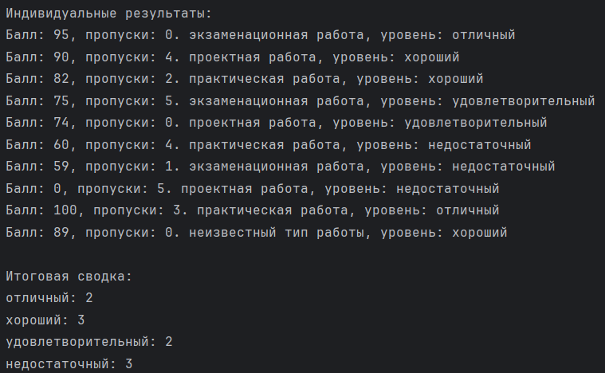
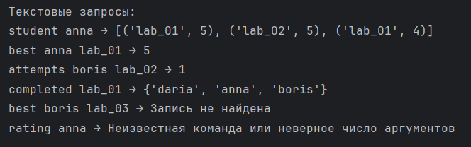
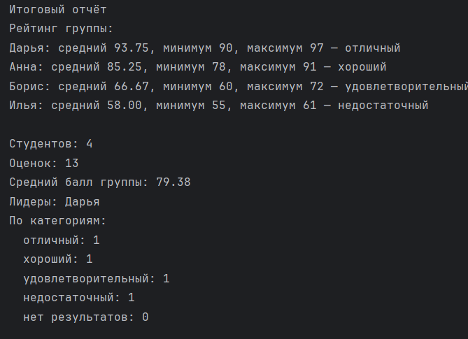

# Лабораторная работа № 3
## Алгоритмы, коллекции и функции

Выполнил Тукмаков Савва Денисович, группа K3121. Проверил Летенков Илья Алексеевич. Дисциплина «Основы программирования».

Цель работы — реализовать базовые алгоритмы, подобрать коллекции для хранения попыток и собрать из отдельных функций анализатор результатов группы. Код запускали в PyCharm.

## Задание 1. Классификация результата

[task_1.py](task_1.py)

Сначала программа спрашивает все три значения. При 100 баллах и пяти пропусках оба значения допустимы. При 90 баллах и шести пропусках программа сообщает об ошибке в количестве пропусков. При 101 балле и шести пропусках срабатывает **первый** `return`, поэтому проверка пропусков и классификация для этой записи уже недостижимы.

Пороги проверяются сверху вниз. Когда программа дошла до условия `score >= 75`, уже известно, что балл меньше 90. При 90 баллах и трёх пропусках уровень отличный. При четырёх пропусках он понижается на хороший. Ниже недостаточного уровень не опускается.

**Таблица 1. Проверка граничных баллов для exam**

| Балл | Пропуски | Ожидалось | Получено |
|---|---|---|---|
| 0 | 5 | недостаточный | недостаточный |
| 59 | 0 | недостаточный | недостаточный |
| 60 | 0 | удовлетворительный | удовлетворительный |
| 74 | 0 | удовлетворительный | удовлетворительный |
| 75 | 0 | хороший | хороший |
| 89 | 0 | хороший | хороший |
| 90 | 3 | отличный | отличный |
| 100 | 4 | хороший | хороший |

При вводе 89, practice и 0 получили «практическая работа» и «хороший». Для неизвестного типа срабатывает ветка `case _`. Тип работы меняет пояснение. После обработки десяти записей сумма четырёх счётчиков равна десяти.



## Задание 2. Циклы и поиск

[task_2.py](task_2.py)

За первый проход получили сумму 144, минимум 7, максимум 21 и четыре чётных числа. Минимум и максимум сначала равны первому элементу списка. Среднее получилось 144 / 10 = 14.4. Теперь можно пройти по списку ещё раз и посчитать значения **строго выше среднего**. Их шесть, повторы тоже учитываются.

**Псевдокод линейного поиска**

```text
Сравнений = 0
Для каждого индекса от 0 до длины списка минус 1:
    Увеличить число сравнений на 1.
    Если элемент равен цели, вернуть индекс и число сравнений.
Вернуть -1 и число сравнений.
```

Первое число 18 нашлось по индексу 3 после четырёх сравнений. При поиске 20 понадобились все десять сравнений, результат −1.

**Псевдокод проверки простоты**

```text
Если число меньше 2, вернуть False.
Начать с делителя 2.
Пока квадрат делителя не превышает число:
    Если остаток от деления равен 0, вернуть False.
    Увеличить делитель на 1.
Вернуть True.
```

У составного числа хотя бы один делитель из пары не превосходит квадратного корня, иначе произведение было бы больше числа. Равенство важно для 49 = 7 × 7. В запуске 1 и 49 дали False, 2 и 29 дали True.

Сортировка выбором находит минимум оставшейся части и ставит его на очередное место. Копия списка после сортировки — `[7, 9, 11, 12, 15, 15, 18, 18, 18, 21]`. Теперь бинарный поиск может отбрасывать половину диапазона. Для 15, 21 и 20 он вернул индексы 4, 9 и −1 за 1, 7 и 8 сравнений. На каждом шаге считается проверка равенства и, если она ложна, сравнение по величине.

**Таблица 2. Поиск последнего элемента**

| Размер | Линейный | Бинарный |
|---|---|---|
| 10 | 10 | 7 |
| 100 | 100 | 13 |
| 1000 | 1000 | 19 |

**Таблица 3. Сложность алгоритмов в худшем случае**

| Алгоритм | Время | Доп. память |
|---|---|---|
| Статистика за два прохода по n элементам | O(n) | O(1) |
| Линейный поиск среди n элементов | O(n) | O(1) |
| Проверка простоты числа x | O(√x) | O(1) |
| Выбор минимума для каждой позиции | O(n²) | O(1) |
| Бинарный поиск среди n элементов | O(log n) | O(1) |

Сама сортировка меняет список на месте. Чтобы сохранить исходные измерения, перед её вызовом создали копию, для которой нужно O(n) памяти.

## Задание 3. Попытки студентов

[task_3.py](task_3.py)

В шести записях встретились три студента и две работы. Множество хранит каждое имя один раз. Список попыток сохраняет порядок и повторы. У Анны три попытки, у Бориса две, у Дарьи одна. Ключ словаря — пара (студент, работа). Разных пар пять. Анна сдавала lab_01 дважды, получила 5 и 4, поэтому счётчик равен 2, а лучший балл равен 5.

Ключ `("anna", "lab_01")` указывает, **чей результат и за какую работу** мы ищем. Этот кортеж из двух строк хешируем: Python может вычислить для него число — хеш, которое словарь использует при поиске ключа. Хеш такого кортежа остаётся постоянным. Список можно изменить, и Python не позволяет использовать его как ключ словаря.

Добавление и поиск в словаре или множестве в среднем занимают O(1). Например, проверка `student in students` обращается к множеству по хешу имени. При поиске в списке элементы проверяются по очереди, поэтому в худшем случае нужно просмотреть все n элементов — O(n). Добавление в конец списка занимает O(1) амортизированно: иногда приходится расширять память под список, но на длинную серию добавлений в среднем приходится постоянное время на элемент.

Чтобы узнать, сдавал ли студент работу, достаточно **присутствия пары** в словаре. Пересечение множеств оставляет общие имена. Изначально обе работы сдавали Анна и Борис. После добавления записи Дарьи обновили только данные новой попытки. У Дарьи за lab_02 одна попытка с баллом 4, и теперь обе работы сдавали все трое.

Запрос разбивается на слова. По команде и числу аргументов программа выбирает операцию. Запрос лучшего балла Бориса за lab_03 показал отсутствие записи, а rating anna попал в ветку неизвестной команды.



## Задание 4. Функции и области видимости

[task_4.py](task_4.py)

Для каждой из четырёх основных функций выполнили по три проверки через `assert`. Такая проверка сравнивает результат с ожидаемым и при несовпадении останавливает обычный запуск с ошибкой. Среднее для [2.0, 6.0] равно 4.0, для [7.5] — 7.5, для [−3.0, 0.0, 3.0] — 0.0. Для пустого списка arithmetic_mean вызывает ValueError. После нормализации имён получили «Анна Иванова», «Борис» и пустую строку для ввода из одних пробелов.

В build_report параметры справа от звёздочки передаются по имени. По умолчанию результат Анны выводится как 4.50. Для Бориса с precision=1 получили 4.3. Для Дарьи с пустым списком ранний return возвращает «нет результатов» до вычисления среднего.

В collect_tags параметр `*tags` собирает позиционные аргументы в кортеж. При вызове звёздочка перед списком распаковывает его элементы в отдельные аргументы. После очистки получили ('python', 'git'). При lowercase=False строки 'Python' и 'python' различаются. Без аргументов получился пустой кортеж (). Распаковка словаря через `**report_options` передала precision и prefix по именам. Результат — «Средний балл: Анна — 4.5».

**Схема поиска имён LEGB**

```text
L  change_course — локальная область
↓
E  show_scope — здесь nonlocal находит course
↓
G  модуль — глобальные course и show_scope
↓
B  встроенные имена — здесь находится print
```

В show_scope имя change_course локальное. До её вызова course равен «Лабораторная № 3», после — «Задание 4». Вложенная функция меняет уже существующую переменную внешней функции. На уровне модуля сохранилось «Основы программирования».

Сначала проверили исходную функцию.

```python
def add_result(value, results=[]):
    results.append(value)
    return results
```

Список в `results=[]` создаётся **при выполнении def**, ещё до первого вызова. Поэтому оба вызова без второго аргумента изменяют один список. Первый вернул `[5]`, второй — `[5, 4]`. Затем перенесли создание списка внутрь функции.

```python
def add_result(value, results=None):
    if results is None:
        results = []
    else:
        results = results.copy()

    results.append(value)
    return results
```

Теперь два вызова дали `[5]` и `[4]`. Если передать список `[3]`, функция работает с его копией. Результат — `[3, 5]`, исходный список остался `[3]`.

Функцию можно передать как аргумент. Для [3, 4, 5] именованная функция прибавила единицу и дала [4, 5, 6], а lambda удвоила значения и дала [6, 8, 10]. При каждом вызове make_threshold_checker создаётся новая функция со своим порогом в замыкании. Для 75 баллов проверка с порогом 60 вернула True, с порогом 90 — False. Ровно 90 баллов проходят порог 90.

## Задание 5. Анализатор учебных результатов

[task_5.py](task_5.py)

В исходной группе было 4 студента и 13 оценок. Средний балл группы получился 79.38. Для этого сложили все оценки и разделили сумму на 13. Первое место в рейтинге заняла Дарья со средним баллом 93.75. Когда у Бориса и Дарьи средний балл оказался одинаковым и самым высоким, в список лидеров попали оба. Для группы без оценок получился пустой список лидеров.



В функции `find_top_students` список лидеров обновляется при обходе студентов.

```python
def find_top_students(students: dict[str, list[int]]) -> list[str]:
    """Возвращает имена всех студентов с наибольшим средним баллом."""
    best_average = None
    leaders = []

    for name, results in students.items():
        average = mean(results)
        if average is None:
            continue

        if best_average is None or average > best_average:
            best_average = average
            leaders = [name]
        elif average == best_average:
            leaders.append(name)

    return leaders
```

Если оценок нет, `continue` переводит цикл к следующему студенту. При первом числовом среднем условие слева от `or` уже истинно, поэтому сравнивать число с `None` не приходится. **При новом максимуме начинаем список лидеров заново, при равенстве добавляем имя.** Так в отдельном сценарии получились два лидера: Борис и Дарья.

**Таблица 4. Контракты функций**

| Функция | Вход | Результат и особые случаи |
|---|---|---|
| mean | Список целых оценок | Среднее. Для пустого списка None |
| minimum | Список целых оценок | Минимум. Для пустого списка None |
| maximum | Список целых оценок | Максимум. Для пустого списка None |
| classify | Среднее или None | Категория по порогам 60, 75 и 90. Для None — «нет результатов» |
| student_summary | Имя и список оценок | Имя, число оценок, среднее, минимум, максимум и категория. Без оценок число равно 0, три числовых результата равны None |
| group_summary | Словарь имён и списков оценок | Число студентов и оценок, среднее и счётчики категорий. При отсутствии оценок среднее равно None |
| find_top_students | Такой же словарь группы | Имена всех лидеров. Если ни у кого нет оценок, пустой список |
| build_ranking | Такой же словарь группы | Новый список сводок по убыванию среднего. Студенты без оценок идут в конце |
| format_report | Рейтинг и сводка группы с полем leaders | Строка с рейтингом и итогами. Для пустой группы выводит «Группа пуста» |

**Таблица 5. Сценарии анализатора**

| Сценарий | Оценок | Ожидаемое среднее | Проверка |
|---|---|---|---|
| Обычная группа | 13 | 1032 / 13 | Пройдена |
| Один студент | 2 | 85 | Пройдена |
| Несколько лидеров | 4 | 91.25 | Пройдена |
| Пустая группа | 0 | None | Пройдена |
| Студент без оценок и студент с нулём | 1 | 0 | Пройдена |
| Границы категорий | 4 | 71 | Пройдена |

Во всех шести сценариях проверки прошли. Нулевой балл относится к категории «недостаточный», а None означает, что оценок нет. Студент без оценок входит в численность группы. Для общего среднего учитываются все выставленные оценки.

Обозначим через S число студентов, а через M — общее число оценок. Чтобы составить сводку группы, нужно посетить каждого студента, даже если у него нет оценок. Это даёт O(S). Обработка оценок занимает O(M). Например, при 13 оценках один полный проход требует 13 просмотров, а три — 39. Если оценок станет вдвое больше, число просмотров тоже вырастет вдвое. Поэтому **общая сводка строится за O(S + M)**.

Для сводки достаточно хранить текущие суммы и счётчики. Например, для подсчёта студентов по категориям нужны пять чисел — по одному для каждой категории. И для четырёх студентов, и для четырёхсот таких счётчиков будет пять. Поэтому дополнительная память для общей сводки — O(1).

В `build_ranking` сначала сохраняем сводку каждого студента, что требует O(S) дополнительной памяти. Подготовка сводок занимает O(S + M). Затем вызываем сортировку:

```python
with_scores.sort(key=lambda summary: summary["average"], reverse=True)
```

Сортируются студенты с оценками. Ключом служит уже вычисленное среднее, а `reverse=True` задаёт порядок по убыванию. Если оценки есть у всех, в сортировку попадают все S студентов. Встроенная сортировка занимает в худшем случае O(S log S) времени. Вместе с подготовкой сводок получаем **O(M + S log S) для построения рейтинга**. Функция `format_report` получает уже упорядоченные записи.

**Вывод.** В задании 5 мы разделили анализ результатов на несколько функций. Теперь по коду можно проследить, как из списка оценок получается строка в рейтинге. Например, для Анны функция `mean` вычисляет средний балл 85.25. Затем `classify` определяет уровень «хороший», а `student_summary` собирает эти результаты вместе с именем, минимумом и максимумом. При построении рейтинга остаётся расположить готовые сводки по убыванию среднего балла.

Такое разделение помогло и при проверке программы. Например, мы отдельно проверили, что `classify(0)` возвращает «недостаточный», а `classify(None)` — «нет результатов». Затем в сценарии с двумя студентами проверили, как это правило работает уже для всей группы: студент с нулевой оценкой попал в рейтинге выше студента без оценок. **Сначала мы проверили само правило, а затем — как оно влияет на итоговый результат.**
